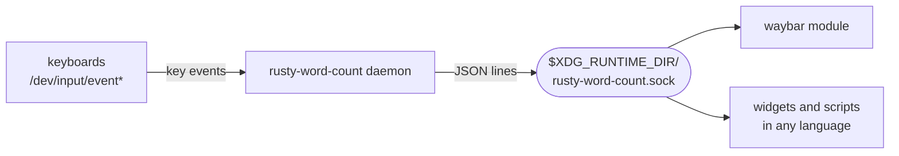

# rusty-word-count

A small background daemon for Linux that works out your typing speed, in words per minute,
from what you actually type, and serves it over a Unix socket. It is made for a waybar
module or a desktop widget, and is easy to query from any language.

```console
$ rusty-word-count get
{"wpm":72,"average":65,"peak":98,"chars":1234,"active_secs":228}
```

- **Light.** One thread, one dependency (`libc`), a binary of about 330 KB and about 2 MB
  of memory. While you are not typing it sleeps without a timer and uses no CPU.
- **Private.** It counts keystrokes. Which keys you pressed is never stored, logged or sent
  to clients.
- **Simple API.** Connect to the socket, send one line, read JSON lines.
- **Follows your keyboards.** Keyboards that are plugged in or reconnect later are picked
  up automatically.

## How it works



The daemon reads key events straight from the kernel (evdev), because Wayland gives
applications no way to observe typing in other windows. Each key press is reduced to
"a character" or "a backspace" and fed into a rolling window, from which the score is
computed. Clients ask for the score over the socket, once or as a stream.

The details are in [`docs/`](docs):

| Document | What it covers |
|---|---|
| [Architecture](docs/architecture.md) | the modules, how data flows through them, the event loop |
| [WPM model](docs/wpm-model.md) | exactly how the score is computed and what counts as typing |
| [Input](docs/input.md) | finding keyboards, hot-plug, permissions, privacy |
| [Protocol](docs/protocol.md) | the socket API, with clients in shell, Python, JavaScript and Go |

## The score

A word is five characters, the usual convention.

| Field | Meaning |
|---|---|
| `wpm` | live speed of the typing in progress, measured over up to 10 seconds; 0 once you pause for 2 seconds |
| `average` | speed over all the time you spent typing since the daemon started |
| `peak` | the highest live speed that was sustained for at least 8 seconds |
| `chars` | characters typed since the daemon started, net of backspaces |
| `active_secs` | seconds spent typing; pauses longer than 5 seconds do not count |

Letters, digits, punctuation, space and enter count as characters. Backspace takes one
away. Shortcuts (anything pressed with Ctrl, left Alt or Super) and auto-repeat are ignored.
Shift and AltGr combinations count, so capitals and characters such as `ą` are typing.
Nothing is saved to disk: the figures start from zero each time the daemon starts.

## Install

You need Linux and Rust 1.88 or newer.

```sh
cargo install --path .
```

This puts `rusty-word-count` in `~/.cargo/bin`.

### Permission to read keyboards

The daemon reads `/dev/input/event*`, which is only readable by root and the `input`
group:

```sh
sudo usermod -aG input "$USER"
```

Log out and back in for the group to apply. If you run the daemon as a systemd user
service, reboot instead, so that the systemd user manager also gets the new group.

Be aware of what this grants: every program you run can then read all input devices,
including everything you type. See [Input](docs/input.md#permissions) before deciding.

## Run

```sh
rusty-word-count daemon
```

To have it start with your session, install the systemd user unit:

```sh
mkdir -p ~/.config/systemd/user
cp contrib/rusty-word-count.service ~/.config/systemd/user/
systemctl --user daemon-reload
systemctl --user enable --now rusty-word-count
```

Then ask for the score:

```sh
rusty-word-count get            # once
rusty-word-count watch          # now, and again every time it changes
rusty-word-count watch waybar   # the same, in the form waybar expects
```

## Waybar

```jsonc
"custom/wpm": {
    "exec": "~/.cargo/bin/rusty-word-count watch waybar",
    "return-type": "json",
    "format": "{} wpm",
    "restart-interval": 5
}
```

The module shows the live figure, with the average and the peak in the tooltip. Its CSS
class is `typing` while the live figure is above zero and `idle` otherwise:

```css
#custom-wpm.idle {
    opacity: 0.4;
}
```

`restart-interval` makes waybar reconnect if the daemon is restarted.

## API

The socket is `$XDG_RUNTIME_DIR/rusty-word-count.sock`. Send `get` or `watch`, optionally
followed by `json` (the default) or `waybar`, and read one JSON object per line.

```sh
echo get | nc -U "$XDG_RUNTIME_DIR/rusty-word-count.sock"
```

```python
import json
import os
import socket

sock = socket.socket(socket.AF_UNIX)
sock.connect(os.environ["XDG_RUNTIME_DIR"] + "/rusty-word-count.sock")
sock.sendall(b"watch\n")
for line in sock.makefile():
    print(json.loads(line)["wpm"], flush=True)
```

The full reference and more clients are in [Protocol](docs/protocol.md).

## Development

```sh
cargo test
```

The tests need no special permissions: they run the daemon against a fake `/dev/input`
built from FIFOs under `target/`. The layout of the code is described in
[Architecture](docs/architecture.md).
