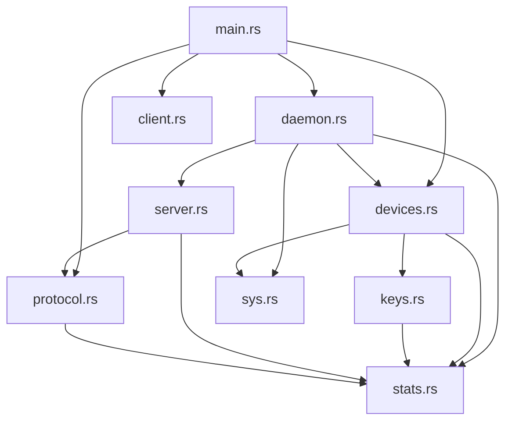
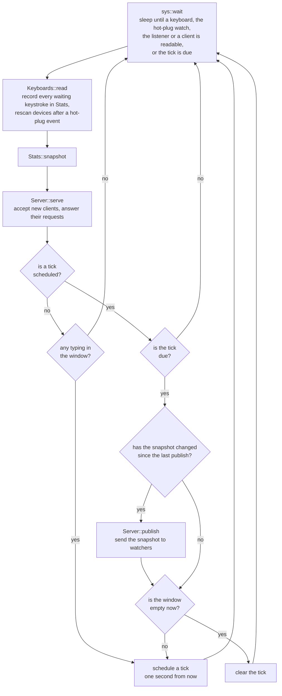

# Architecture

rusty-word-count is one binary with three commands. `daemon` is the long-running part:
it reads the keyboards, keeps the score and serves it on a Unix socket. `get` and `watch`
are thin clients that send one request to that socket and print the reply.

Everything in the daemon happens on one thread, in one loop around `poll(2)`.

## Data flow

```mermaid
flowchart LR
    nodes["/dev/input/event*"]
    devices["devices::Keyboards"]
    keys["keys::Decoder"]
    stats["stats::Stats"]
    protocol["protocol::View"]
    server["server::Server"]
    clients["clients"]

    nodes -->|"raw input events"| devices
    devices -->|"bytes"| keys
    keys -->|"Char or Backspace"| stats
    stats -->|"Snapshot"| protocol
    protocol -->|"one JSON line"| server
    server -->|"Unix socket"| clients
```

A keystroke loses its identity at the second arrow: `keys::Decoder` turns each event into
`Key::Char`, `Key::Backspace` or nothing, and only that reaches the rest of the program.

## Modules

| Module | Role | Does I/O |
|---|---|---|
| `main.rs` | parses the command line and dispatches | no |
| `daemon.rs` | the event loop that ties the others together | through the others |
| `devices.rs` | finds keyboards, reads them, follows hot-plug | yes |
| `keys.rs` | decodes evdev events and classifies keys | no |
| `stats.rs` | the WPM maths | no |
| `server.rs` | the socket listener and its clients | yes |
| `protocol.rs` | parses request lines and renders snapshots | no |
| `client.rs` | the `get` and `watch` commands | yes |
| `sys.rs` | wrappers for `poll` and inotify, the only `unsafe` | yes |

An arrow means "uses". `stats.rs` sits at the bottom because it defines the two types
that everything else passes around: `Key` (what goes in) and `Snapshot` (what comes out).
The three modules without I/O (`keys`, `stats`, `protocol`) hold all the logic that can be
wrong in interesting ways, and are covered by unit tests that need no devices and no clock.

The crate is a library (`src/lib.rs`) with a small binary on top (`src/main.rs`). That
split exists so the integration tests can drive the real daemon loop.

## The event loop

`daemon::run` repeats these steps forever:

Two properties follow from this shape.

**Idle costs nothing.** With no tick scheduled, `poll` is called without a timeout, so the
process is not woken until a key is pressed or a client connects. The tick only runs
while there are keystrokes inside the 10 second window, which is also the only time the
live figure can change.

**Watchers get at most one line per second.** Keystrokes are recorded as they arrive, but
the score is only published on the tick, and only if it differs from what was published
last. A `get` is answered immediately with a fresh snapshot.

After `poll` returns, the loop does not check which descriptor was ready. It makes one
non-blocking read on each keyboard and each client instead. With a handful of
descriptors that is a few extra system calls per wake-up, and it removes the bookkeeping
of matching `poll` results back to their owners.

## Design choices

**One thread, no async runtime.** There are two kinds of event source (devices and
sockets) and one piece of state. A `poll` loop handles that directly, and because nothing
is shared between threads there are no locks.

**One dependency.** `libc` is needed for `poll` and inotify, which the standard library
does not expose. Everything else uses std:

- Device nodes are opened with `OpenOptions`, and events are decoded from bytes with
  `from_ne_bytes`, so reading evdev needs no `unsafe`.
- Keyboards are recognised from sysfs text files rather than `ioctl`.
- JSON is only ever written, never parsed, and every value is an integer or a fixed
  string. A `format!` call does it.

**All `unsafe` in one file.** `sys.rs` has four one-line `unsafe` blocks (three system
calls and taking ownership of a descriptor) and exposes two safe functions: `wait` and
`watch_dir`.

**Time is an argument.** `Stats::record` and `Stats::snapshot` take the current `Instant`
instead of reading the clock, so the tests for the maths place keystrokes at exact times
and run instantly.

**The filesystem root is an argument.** `Keyboards::open_in(root)` looks for
`dev/input` and `sys/class/input` under `root`; `Keyboards::open()` passes `/`. The tests
pass a directory under `target/` in which FIFOs stand in for device nodes.

## Tests

| Where | What it covers |
|---|---|
| `src/stats.rs` | the live figure, decay, backspace, average and peak |
| `src/keys.rs` | which keys count, modifiers, repeats, non-key events |
| `src/protocol.rs` | request parsing and both renderings |
| `tests/devices.rs` | discovery, filtering of non-keyboards, hot-plug |
| `tests/daemon.rs` | the daemon end to end over its socket, and socket takeover |

`tests/common/mod.rs` builds the fake root that both integration tests use.
