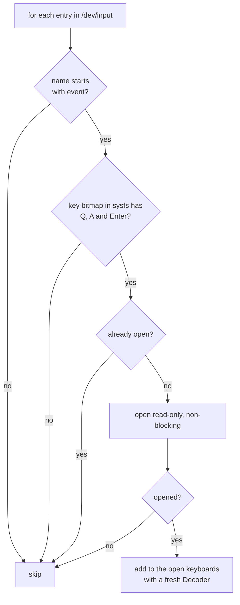
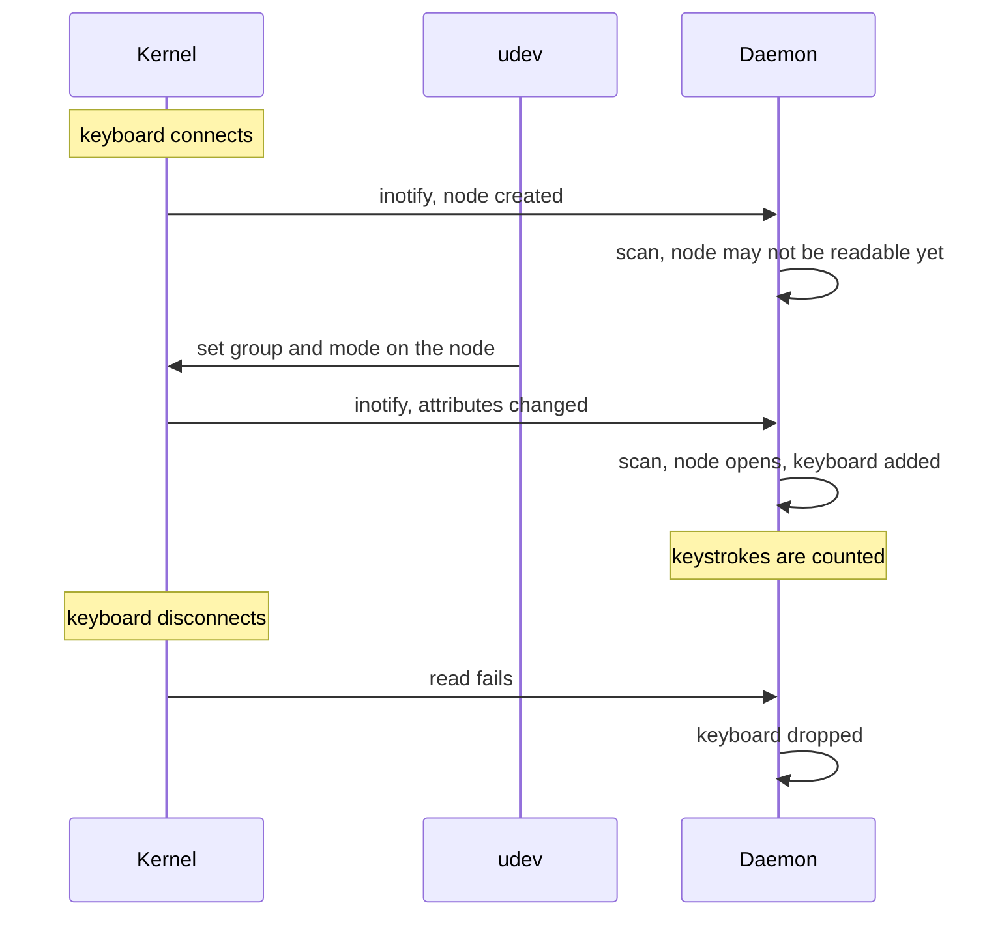
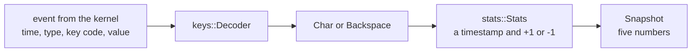

# Input

This document describes how the daemon gets at keystrokes: where they come from, how
keyboards are found and followed, what permission that needs, and what is kept. The code
is in `src/devices.rs`, `src/keys.rs` and `src/sys.rs`.

## Why evdev

Under Wayland an application only receives the keys typed into its own windows, and there
is no protocol for observing typing elsewhere. The daemon therefore reads from the layer
below the compositor: the kernel's evdev interface, where every input device is a
character device `/dev/input/eventN` that produces a stream of fixed-size events.

Devices are opened read-only and non-blocking. They are never grabbed, so the daemon
cannot interfere with input reaching the compositor.

## Finding keyboards

`/dev/input` holds much more than keyboards: mice, touchpads, power buttons, lid switches,
audio jacks. `Keyboards::scan` picks the keyboards out:



- **Only `event*` nodes.** A device can have other nodes, such as `mouse0`, which speak
  older protocols.
- **Capabilities come from sysfs.** The kernel publishes each device's key bitmap as text
  in `/sys/class/input/eventN/device/capabilities/key`. A device is a keyboard if it has
  the Q, A and Enter keys. That test rejects devices which only have a few keys, such as
  a power button, a laptop's hotkey device or a receiver's media-key interface.
- **A failed open is not an error.** It usually means the node is not readable yet (see
  hot-plug below) or the user lacks permission. If no keyboard at all can be opened at
  startup, the daemon prints a warning and keeps running.

## Hot-plug

USB keyboards are unplugged, Bluetooth keyboards go to sleep and reconnect. The daemon
holds an inotify watch on `/dev/input` and rescans when it fires:



The watch covers both creation and attribute changes because a node can appear before
udev has applied its group and mode. The first scan may then fail to open it, and the
attribute change triggers the scan that succeeds.

There is no event for removal. A removed device makes its descriptor readable with an
error, and any read error other than "nothing to read right now" drops the keyboard.

## Key remappers

Remappers such as keyd and kanata grab the physical keyboards and re-emit keys through a
virtual keyboard. The daemon opens the physical keyboards and the virtual one, since all
of them have letter keys, but a grabbed device delivers its events only to the program
that grabbed it. Each keystroke is therefore seen once, on the virtual keyboard, after
remapping.

## Permissions

Device nodes belong to `root:input` with mode `0660`, so the daemon's user must be in the
`input` group:

```sh
sudo usermod -aG input "$USER"
```

The group applies to new login sessions. A systemd user service runs under the user
manager, which keeps its old groups until it restarts, so a reboot is the reliable way to
apply the change there.

This is a real trade-off. Membership of `input` is not limited to this daemon: every
program running as you can then read every input device, which includes everything typed
anywhere, passwords too. Wayland otherwise prevents exactly that. The daemon has no
narrower way of getting at keystrokes built in.

The daemon does not need root and should not be run as root.

## What is kept from a keystroke



- The key code is looked at once, inside `Decoder`, to decide between "character",
  "backspace" and "ignore". It is not passed on.
- The only per-key state is whether each shortcut modifier is currently held.
- `Stats` keeps the time of each counted key press for 10 seconds, with no record of
  which key it was.
- Clients receive five numbers: `wpm`, `average`, `peak`, `chars` and `active_secs`.
- Nothing is written to disk and nothing is logged about keys.

What a client can learn is when and how fast you type, not what.
