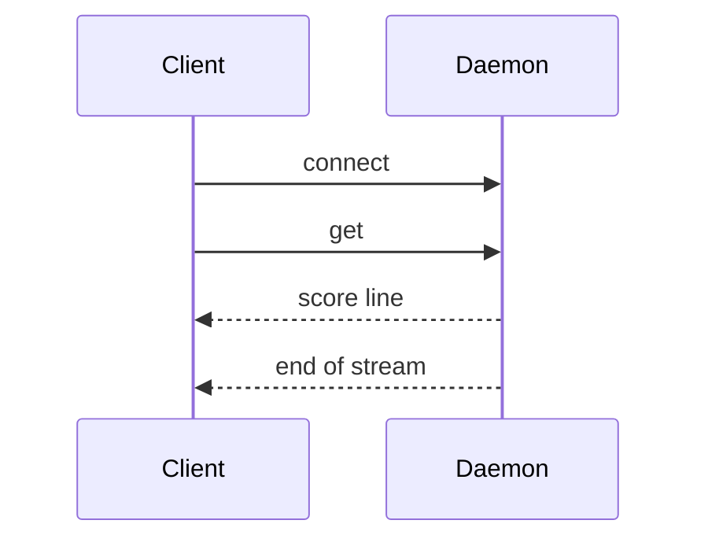
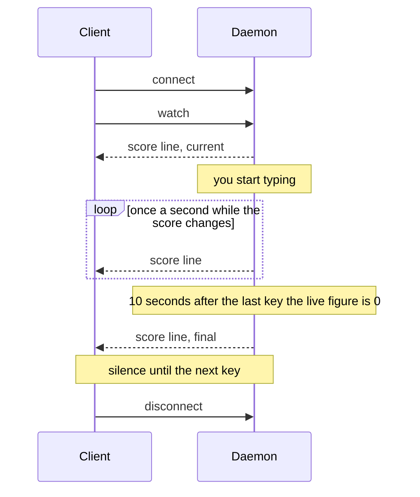

# Protocol

The daemon serves the score on a Unix stream socket. A client connects, sends one line of
text and reads lines of JSON. The code is in `src/server.rs` and `src/protocol.rs`.

## Socket

```
$XDG_RUNTIME_DIR/rusty-word-count.sock
```

`XDG_RUNTIME_DIR` is normally `/run/user/<uid>`, a directory only its owner can enter, so
only your own programs can reach the socket.

## Requests

A request is one line, ended by a newline:

```
<command> [<view>]
```

| Command | Reply |
|---|---|
| `get` | one line with the current score, then the daemon closes the connection |
| `watch` | one line with the current score, then a new line whenever it changes |

| View | Form of each line |
|---|---|
| `json` | every figure. This is the default when no view is given. |
| `waybar` | what a waybar custom module with `"return-type": "json"` expects |

Each connection takes one request. Anything that is not a valid request is answered with
this line, and the connection is closed:

```json
{"error":"unknown request"}
```

### `get`



Because the daemon closes the connection, a client can simply read until end of stream.

### `watch`



A watcher gets at most one line per second, and only when the score differs from the last
one published. While you are not typing nothing is sent, so a watching client can block on
its read and use no CPU either. The stream ends when the client disconnects or the daemon
stops.

## Views

### `json`

```json
{"wpm":72,"average":65,"peak":98,"chars":1234,"active_secs":228}
```

| Field | Type | Meaning |
|---|---|---|
| `wpm` | integer | live speed over the last 10 seconds, in words per minute |
| `average` | integer | speed over all typing time since the daemon started |
| `peak` | integer | highest live speed sustained for at least 8 seconds |
| `chars` | integer | characters typed since the daemon started, net of backspaces |
| `active_secs` | integer | seconds spent typing |

The fields always appear, in this order. How they are computed is described in
[WPM model](wpm-model.md).

### `waybar`

```json
{"text":"72","tooltip":"average 65 · peak 98","class":"typing"}
```

| Field | Meaning |
|---|---|
| `text` | the live speed |
| `tooltip` | the session average and peak |
| `class` | `typing` while the live speed is above 0, otherwise `idle` |

## Limits

- The newline that ends a request must come within the first 64 bytes sent.
- The daemon serves up to 64 connections at a time. Further ones are closed immediately.
- A watcher that stops reading is disconnected once its socket buffer is full.

## Command line

The `rusty-word-count` binary is also a client. Its arguments are the request:

```sh
rusty-word-count get
rusty-word-count get waybar
rusty-word-count watch
rusty-word-count watch waybar
```

It prints the reply lines as they arrive. It exits with status 1 if the daemon cannot be
reached, and with status 2 and a usage message if the arguments are not a valid request.

## Clients

### Shell

```sh
echo get | nc -U "$XDG_RUNTIME_DIR/rusty-word-count.sock"
```

```sh
echo "watch waybar" | socat - "UNIX-CONNECT:$XDG_RUNTIME_DIR/rusty-word-count.sock"
```

### Python

```python
import json
import os
import socket

sock = socket.socket(socket.AF_UNIX)
sock.connect(os.environ["XDG_RUNTIME_DIR"] + "/rusty-word-count.sock")
sock.sendall(b"watch\n")
for line in sock.makefile():
    score = json.loads(line)
    print(score["wpm"], score["average"], score["peak"], flush=True)
```

### JavaScript (Node.js or Bun)

```js
import net from "node:net";
import readline from "node:readline";

const path = `${process.env.XDG_RUNTIME_DIR}/rusty-word-count.sock`;
const socket = net.createConnection(path);
socket.write("watch\n");

for await (const line of readline.createInterface({ input: socket })) {
  const score = JSON.parse(line);
  console.log(score.wpm, score.average, score.peak);
}
```

### Go

```go
package main

import (
	"encoding/json"
	"fmt"
	"net"
	"os"
)

type Score struct {
	WPM        int `json:"wpm"`
	Average    int `json:"average"`
	Peak       int `json:"peak"`
	Chars      int `json:"chars"`
	ActiveSecs int `json:"active_secs"`
}

func main() {
	conn, err := net.Dial("unix", os.Getenv("XDG_RUNTIME_DIR")+"/rusty-word-count.sock")
	if err != nil {
		panic(err)
	}
	defer conn.Close()
	fmt.Fprintln(conn, "get")

	var score Score
	if err := json.NewDecoder(conn).Decode(&score); err != nil {
		panic(err)
	}
	fmt.Println(score.WPM, score.Average, score.Peak)
}
```

### Waybar

```jsonc
"custom/wpm": {
    "exec": "~/.cargo/bin/rusty-word-count watch waybar",
    "return-type": "json",
    "format": "{} wpm",
    "restart-interval": 5
}
```

Without an `interval`, waybar keeps the command running and updates the module on every
line it prints. `restart-interval` starts the command again five seconds after it exits,
which reconnects the module when the daemon is restarted.
