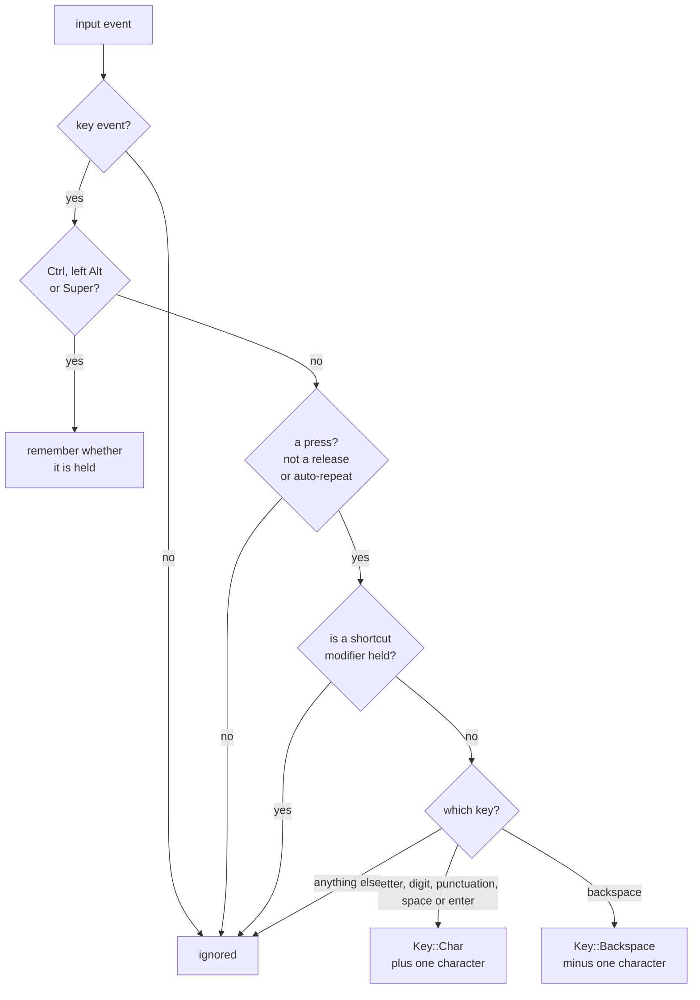
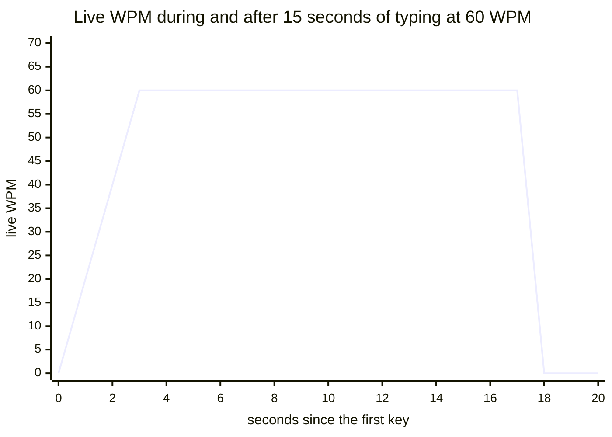

# WPM model

This document describes how the score is computed. The code is in `src/stats.rs`, and the
rules for which keys count are in `src/keys.rs`.

## What counts as typing

A word is five characters. A "character" is one press of a typing key, so the first
question is which key events count:



In more detail:

- **Characters** are the digit row, the three letter rows with their punctuation keys,
  space, enter and the extra key next to left Shift on ISO keyboards.
- **Backspace** takes one character away. This makes the score a net speed: text you type
  and then delete does not count.
- **Shortcuts are not typing.** While Ctrl, left Alt or Super is held, nothing counts, not
  even backspace, because Ctrl+Backspace removes a whole word and there is no telling how
  long it was.
- **Shift and right Alt (AltGr) are not shortcut modifiers.** They produce capitals and
  characters such as `ą`, so keys pressed with them count.
- **Auto-repeat is ignored.** Holding a key down is one press.
- **Tab, Escape, arrows, function keys and the keypad are ignored.**

Modifier state is tracked per keyboard.

## The figures

| Constant | Value | Meaning |
|---|---|---|
| `WINDOW` | 10 s | how far back from the newest key the live figure looks |
| `PAUSE` | 2 s | how long without a key until the live figure drops to 0 |
| `MIN_SPAN` | 3 s | the shortest time any rate is measured over |
| `PEAK_MIN_SPAN` | 8 s | how much time the live figure must cover to count as a peak |
| `IDLE_GAP` | 5 s | the longest pause that still counts as typing time |
| `CHARS_PER_WORD` | 5 | |

Every rate uses the same formula, and is rounded to a whole number:

```
rate(characters, span) = characters / 5 / (max(span, 3 s) in minutes)
```

### Live: `wpm`

The live figure is the speed of the typing in progress. The daemon keeps the counted key
presses of the current burst, each as +1 or -1, going back at most 10 seconds from the
newest one. This is the window.

```
span = time from the oldest key in the window to the newest
wpm  = rate(sum of the window without its oldest key, but at least 0; span)
```

Three details matter here:

- **The window ends at the newest key, not at the present moment.** Between two keys the
  figure therefore holds steady instead of sagging while you think about the next word.
- **The oldest key is left out of the sum.** It marks where the measured time starts: 51
  keys at five per second cover exactly 10 seconds and are 50 characters' worth of typing.
- **The span is the real one, not always 10 seconds.** That makes the figure correct from
  about three seconds into a burst instead of ramping up over ten. The 3 second minimum
  keeps the first few keys from reading as an absurd speed.

When more than 2 seconds pass without a key, the burst is over: the window is emptied and
the figure is 0. It does not slide down. The next key starts a new window, so what you
typed before the pause has no effect on the new figure.

This is what the live figure does when you type steadily at 60 WPM (five keys per second)
for 15 seconds and then stop:



| Seconds | What happens |
|---|---|
| 0 to 3 | the rate is measured over the 3 second minimum, so it climbs: 20, 40, 60 |
| 3 to 15 | the figure is exact |
| 15 to 17 | typing has stopped; the figure holds |
| after 17 | more than 2 seconds without a key: the figure is 0 and the daemon goes back to sleep |

The daemon looks at the clock once a second while typing is in progress, so clients see the
drop to 0 between 2 and 3 seconds after the last key.

### Session: `chars`, `active_secs`, `average`

`chars` is the number of characters since the daemon started, net of backspaces. It never
goes below zero.

`active_secs` is the time spent typing. The gap between two consecutive counted keys is
added to it when the gap is 5 seconds or less. Longer pauses are thinking, reading or being
away, and are left out.

```
average = rate(chars, active time)
```

Unlike the live figure, the average counts every character, including the first key of
each burst, which has no gap before it. In the example above, 76 keys cover 15 seconds, so
the average reads 61 while the live figure reads 60. Over a longer session the difference
disappears.

### Session: `peak`

`peak` is the highest live figure seen, with one condition: it is only updated when the
window spans at least 8 seconds. Since a pause of more than 2 seconds empties the window,
that means at least 8 seconds of typing without such a pause, so a short sprint cannot set
a record. In the example, the peak becomes 60 at second 8.

Nothing is written to disk. All figures start again from zero when the daemon restarts.

## What the model cannot see

The daemon sees key presses, not the text that results from them. That keeps it simple
and private, and it has consequences:

- **Layouts do not matter.** A press of a typing key is one character whatever the layout
  maps it to.
- **Dead keys and compose sequences** count once per key pressed, not once per resulting
  character.
- **Completion and pasting** are invisible. Text your editor inserts for you is not counted,
  and neither is pasted text.
- **Deleting a selection** counts as one backspace, however much was selected.
- **Accuracy is not measured.** There is no reference text, so a typo you leave in counts
  the same as a correct character. Only what you delete is subtracted.
